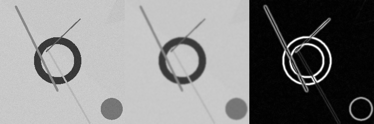

# CUDA Batch Edge Detection

A GPU image-processing pipeline that runs **edge detection on hundreds of images
in a single execution**. Every image goes through

```
RGB image ──► grayscale ──► Gaussian blur (row pass) ──► Gaussian blur (column pass) ──► Sobel gradient ──► edge map
```

entirely on the GPU, using several CUDA streams so that the copies of one image
overlap with the kernels of another. Every GPU result can be checked against a
CPU implementation of the same algorithm (`--verify`). The program also logs
per-image timings and writes a summary with throughput and GPU-vs-CPU speedup.

This is the independent project for the Coursera course *CUDA at Scale for the
Enterprise*.

---

## Highlights

| What | How |
|---|---|
| Large batch | 256 images (240 × 256×256 + 16 × 1024×1024, 32.5 megapixels) processed in one run |
| Custom CUDA kernels | `RgbToGrayKernel`, `GaussianRowKernel`, `GaussianColumnKernel`, `SobelKernel`, `FloatToByteKernel` |
| Separable Gaussian | One 2-D *k×k* blur is split into two 1-D passes: 2*k* instead of *k²* reads per pixel (11 vs 121 for σ = 1.4) |
| Constant memory | Gaussian weights are stored in `__constant__` memory. All threads in a warp read the same weight, so the constant cache broadcasts it to them |
| Concurrency | `--num_streams` CUDA streams, each with its own pinned host buffers and device buffers. Asynchronous copies, and per-image timing with CUDA events |
| Correctness | The same per-pixel functions (`src/pixel_ops.h`, `__host__ __device__`) are used by the GPU kernels and by the CPU reference. `--verify` compares every output pixel |
| Robustness | Mixed image sizes in one batch (buffers grow as needed). Unreadable files are skipped and logged. Arguments are validated |
| Engineering | Command-line options (`getopt_long`), `Makefile`, `run.sh`, a reproducible dataset generator, Google C++ style (passes `cpplint`) |

---

## Quick start

On a machine with an NVIDIA GPU and the CUDA toolkit (for example the course lab):

```bash
./run.sh
```

`run.sh` will

1. build `bin/edge_detect` and `bin/generate_dataset` (`make build`),
2. generate the dataset in `data/input/` on the first run (`make data`),
3. process every image on the GPU with verification turned on, and write
   - `output/edges/*_edges.png`: one edge map per input image,
   - `output/gallery/*_gallery.png`: side-by-side previews (input | blurred | edges),
   - `logs/run_log.txt`: one line per image (stream, size, GPU time, CPU time, verification result),
   - `logs/summary.md`: the totals (throughput, speedup, verification).

Any extra arguments are passed on to the program, for example
`./run.sh --num_streams 8 --threshold 60`.

## Building manually

```bash
make                 # builds bin/edge_detect and bin/generate_dataset
make data            # writes 256 synthetic test images to data/input
make run ARGS="-i data/input -o output --verify"
make clean           # remove build products
make clean-all       # also remove data, outputs and logs
make ARCH="-arch=sm_75"   # optional: build for a specific GPU architecture
```

Requirements: CUDA toolkit 11 or newer (`nvcc`), `g++` with C++17, and `make`.
There are no other dependencies. Image loading and saving use the single-header
[stb](https://github.com/nothings/stb) libraries in `third_party/stb` (public
domain / MIT).

## Command line

```
./bin/edge_detect [options]
```

| Option | Default | Description |
|---|---|---|
| `-i, --input_dir DIR` | `data/input` | Folder of input images (PNG, JPG, BMP, TGA, PGM, PPM) |
| `-o, --output_dir DIR` | `output` | Output folder (`edges/` and `gallery/` are created inside it) |
| `-l, --log_file FILE` | `logs/run_log.txt` | Per-image log (also printed to the screen) |
| `-S, --summary_file FILE` | `logs/summary.md` | Markdown summary table |
| `-s, --sigma F` | `1.4` | Gaussian standard deviation in pixels (0.1–5). Radius = ⌈3σ⌉ |
| `-t, --threshold F` | `0` | `0` writes the gradient magnitude; `> 0` writes a binary edge map |
| `-n, --num_streams N` | `4` | Number of concurrent CUDA streams (1–32) |
| `-b, --block_size N` | `16` | Threads per block = N × N (N² ≤ 1024) |
| `-m, --max_images N` | all | Process only the first N images |
| `-g, --gallery N` | `6` | Number of side-by-side previews to write |
| `-d, --device N` | auto | GPU index. By default the GPU with the most multiprocessors is used |
| `-v, --verify` | off | Run the CPU reference on every image and compare the results |
| `-h, --help` | | Show help |

## Dataset

`tools/generate_dataset.cc` creates a reproducible dataset. The same seed
always gives the same images. Each image has a random two-color gradient
background, 6–15 random filled or outlined shapes (circles, rings, rectangles,
triangles, thick lines) and Gaussian sensor noise (σ = 6). The noise is the
reason for the blur stage: without smoothing, Sobel would respond to the noise
instead of to the shape edges.

* 240 small images, 256×256 (`small_0000.png` … `small_0239.png`, seed 2026)
* 16 large images, 1024×1024 (`large_0000.png` … `large_0015.png`, seed 7)

The input images are not committed to the repository because they take about
90 MB. `make data` recreates exactly the same files. You can also point
`--input_dir` at any folder of your own photos.

## Proof of execution

After running `./run.sh` in the lab, these files are committed to the
repository:

* [`logs/run_log.txt`](logs/run_log.txt): the GPU used, then one line for each
  of the 256 images, then the summary.
* [`logs/summary.md`](logs/summary.md): throughput, GPU and CPU time, speedup
  and the verification result.
* [`output/edges/`](output/edges): 256 edge maps, one per input image.
* [`output/gallery/`](output/gallery): previews. Each one shows grayscale input | blurred | edges:




## Code structure

```
src/
  main.cu            batch driver: device selection, stream scheduling, logging, summary
  edge_pipeline.cu   CUDA kernels + StreamWorker (stream, events, pinned/device buffers)
  edge_pipeline.cuh
  pixel_ops.h        __host__ __device__ per-pixel math shared by GPU and CPU
  cpu_reference.cc   single-threaded CPU version of the pipeline (verification, speedup)
  cpu_reference.h
  image_io.cc        directory listing, image loading (stb_image), PNG writing
  image_io.h
  cli_options.cc     getopt_long parsing and validation of the arguments
  cli_options.h
tools/
  generate_dataset.cc  reproducible synthetic dataset generator
third_party/stb/       stb_image.h, stb_image_write.h
Makefile, run.sh
```

### How the batch is scheduled

Image *i* is assigned to stream *i mod N*. Before a stream receives a new image,
the program first finishes that stream's previous image: it waits for the
stream, writes the PNG and runs the verification. Only then does it decode the
next image into that stream's pinned buffer and queue the copy to the GPU, the
4 kernels and the copy back. While the CPU is decoding and encoding PNGs for
one stream, the other N − 1 streams keep the GPU busy. If a larger image
arrives, the stream's buffers grow; they never shrink, so no memory is
allocated in the steady state.

### Why the GPU and CPU results match exactly

By default the GPU fuses `a * b + c` into a single fused multiply-add (FMA)
instruction, which rounds differently from the CPU. The Makefile builds with
`--fmad=false`. Together with the shared `__host__ __device__` functions, this
makes the GPU and the CPU compute bit-identical results, so `--verify` can
require an exact match in threshold mode and allows at most ±1 in magnitude
mode.

## License

MIT, see [LICENSE](LICENSE). The stb headers in `third_party/stb` are by Sean
Barrett (public domain / MIT).
